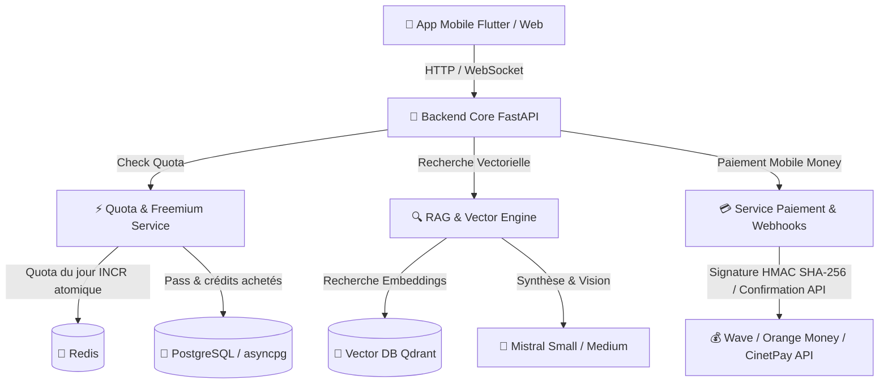

# 📘 Document des Exigences Produit (PRD/PDR) — ProsArtisan IA Expert

Ce document constitue le **Product Requirements Document (PRD)** et la **Fiche de Référence Produit & Architecture (PDR)** de l'assistant IA **ProsArtisan**, conçu pour accompagner les artisans du BTP et des métiers d'art en Côte d'Ivoire et en Afrique de l'Ouest. Le fichier historique reste nommé `PDR.md`, mais il est la source de vérité produit du dépôt.

---

## 🎯 1. Vision & Objectifs Produit

ProsArtisan IA est un copilot technique conversationnel accessible via Web & Mobile. Il résout les défis du terrain :
- **Support Métier Précis** : Réponses techniques structurées étape par étape (maçonnerie, électricité, plomberie, charpente, carrelage, mécanique, maroquinerie, etc.).
- **Compréhension Multilingue & Nouchi** : Prise en charge du français, du Nouchi (argot des chantiers ivoiriens), Dioula, Baoulé et Bété.
- **Multimodalité Photo (Vision Mistral)** : Analyse de photos de chantier (fissures, installations électriques, défaillances mécaniques).
- **Monétisation Mobile Money Locale** : Paiement ultra-simple via Wave Business, Orange Money & CinetPay (Pass 24H Urgence à 500 F CFA, Pass Mensuel Pro à 3000 F CFA, Pack 50 requêtes à 1500 F CFA).
- **Mode Hors-Ligne & Robustesse** : Mémoire locale et réponses rapides sur réseaux mobiles 3G/4G faibles.

---

## 🏗️ 2. Architecture Technique Global



### Stack Technique
- **Langage & Framework** : Python 3.12, FastAPI, Pydantic v2.
- **Base de Données Relationnelle** : PostgreSQL, SQLAlchemy 2.0 (AsyncIO), Asyncpg, Alembic. Pool de connexions dimensionné (`DB_POOL_SIZE`/`DB_MAX_OVERFLOW`/`DB_POOL_RECYCLE`), `pool_pre_ping` actif.
- **Cache & Rate Limiting** : Redis (compteurs de quota/rate-limit partagés entre workers), avec repli en mémoire locale si Redis est indisponible (dev/tests uniquement) ; une connexion Redis perdue est retentée toutes les 30 s. En production, les préfixes `prosartisan:security:`, `prosartisan:revoked_jti:`, `prosartisan:rate_limit:` et `prosartisan:quota:` refusent le repli mémoire. Le rate limiting (60 req/min par IP) couvre `/api/chat*`, `/api/auth*` et chaque message du WebSocket `/api/chat/ws`. L'IP cliente est lue dans `X-Forwarded-For` en partant de la droite selon `TRUSTED_PROXY_HOPS` (nombre de reverse proxies de confiance : 1 derrière Caddy/Render/Cloud Run, 0 en accès direct).
- **Quotas freemium** (`app/services/quota_service.py`) : ordre de consommation Pass premium actif → quota gratuit du jour (`MAX_QUESTIONS_GRATUITES_PAR_JOUR`, compteur Redis `INCR` atomique par jour UTC = heure d'Abidjan, expirant seul — aucune tâche de remise à zéro) → crédits achetés (`quotas_utilisateurs.credits_requetes`, décrémentés par `UPDATE ... WHERE credits_requetes > 0`). Un visiteur non connecté est compté par IP cliente (hachée), jamais sur un compteur commun à tous les anonymes. Redis injoignable en production → `503` (jamais un quota accordé ou refusé à l'aveugle).
- **Base Vectorielle & RAG** : Qdrant (`qdrant-client`). Vecteurs : `EMBEDDING_PROVIDER=gemini` par défaut (`gemini-embedding-001`, 1536 dimensions via `GEMINI_EMBEDDING_DIMENSIONS`, `taskType` `RETRIEVAL_DOCUMENT` à l'indexation et `RETRIEVAL_QUERY` à la recherche, appel `batchEmbedContents`) ou `mistral` (`mistral-embed`, 1024). Chaque modèle a sa collection : `connaissances_prosartisan_gemini_1536` pour Gemini, le nom historique `connaissances_prosartisan` pour Mistral ; le cache des vecteurs et le manifeste d'ingestion sont propres au modèle, si bien que changer de modèle réindexe tout le corpus au prochain `python -m ingestion.pipeline` et impose de recalibrer `RAG_MIN_SCORE`. Une collection existante d'une autre dimension est signalée au démarrage. La collection est créée automatiquement au démarrage de l'application si elle est absente. Sans extrait pertinent retrouvé (et sans photo à analyser), le service RAG renvoie le message de repli standard sans appeler le LLM (garde-fou zéro hallucination, voir AGENTS.md §3). Un extrait n'est pertinent que si son score cosinus atteint `RAG_MIN_SCORE` (0.71 par défaut, calibré le 2026-11-21 pour `gemini-embedding-001` sur les 37 guides : questions couvertes ≥ 0.7205, hors corpus ≤ 0.6948 ; à recalibrer avec `python -m app.scripts.calibrer_seuil_rag` et le jeu `ingestion/evaluation/questions_seuil_rag.jsonl` après tout changement de modèle de vecteurs ou ajout important au corpus). Option désactivée par défaut (`RAG_REFORMULATION_REQUETE=false`, voir le calibrage du 21 novembre) : avant la recherche, la question peut être reformulée en français technique (appel LLM court mis en cache 7 jours) ; la question d'origine et sa reformulation sont toutes deux cherchées, leurs extraits fusionnés, et le LLM reçoit toujours la question d'origine. Sans aucune clé IA valide (dev/tests uniquement : la production refuse de démarrer), un mode démonstration sert une réponse générique explicitement signalée comme telle, jamais mise en cache. Une panne de la recherche (embedding Mistral ou Qdrant injoignable) n'est jamais traitée comme une absence d'information : `search_context` lève `RechercheIndisponibleError`, `/api/chat`, `/api/chat/stream` et le WebSocket répondent par une erreur (`503`) et rendent la question, et rien n'est mis en cache — le repli n'est servi et mis en cache (24 h) qu'après une recherche aboutie sans extrait pertinent. Seul le mode mock tolère un Qdrant absent (repli servi, non mis en cache). Les modes réponse complète et streaming partagent la même préparation (`RAGService._prepare`) : métier suspendu, cache, repli zéro hallucination et calculateurs certifiés (en streaming, les appels d'outil sont reconstitués depuis le flux, exécutés, puis la réponse finale est streamée). La recherche utilise `query_points` (Qdrant). Les états d'activation (métiers et documents désactivés) sont mis en cache Redis 60 s et invalidés par les routes admin (`invalidate_activation_cache`) ; chaque invalidation, et chaque ingestion ayant traité un document, change la version des réponses RAG en cache (clé `prosartisan:rag:v<version>:...`), qui ne peuvent donc plus citer un document désactivé ni masquer un document nouvellement ajouté. Les embeddings d'ingestion sont calculés par lots de 16.
- **Intelligence Artificielle & Bascule Multi-Fournisseurs (`app/services/llm_provider_service.py`)** : Orchestration haute disponibilité entre **Mistral AI** (`mistral-small-latest` / `mistral-medium-latest`, Voxtral STT/TTS) et **Google Gemini** (`gemini-3.8-flash` via l'API Interactions `/v1beta/interactions`, `gemini-3.5-transcribe` pour le STT, avec support de `GEMINI_BASE_URL` direct ou derrière Cloudflare AI Gateway). Mode par défaut : `LLM_PROVIDER=gemini` (Gemini prioritaire, Mistral en secours si sa clé est configurée et `LLM_FAILOVER_ENABLED=true`) ; un mode choisi dans le back-office (Redis) prime sur cette valeur. En mode `auto` (ou avec `LLM_FAILOVER_ENABLED=true`), le système mesure en continu le score de stabilité, les échecs consécutifs et la latence dans Redis (`prosartisan:llm:health:*`), active un coupe-circuit temporaire (`cooldown`) après `LLM_CIRCUIT_BREAKER_THRESHOLD` pannes consécutives, et bascule automatiquement vers le fournisseur sain sans perte de question pour l'artisan. Les vecteurs proviennent d'un seul modèle à la fois (`EMBEDDING_PROVIDER`, Gemini par défaut) pour garantir la cohérence géométrique de la collection Qdrant ; lorsque la clé du fournisseur de vecteurs manque (par exemple `EMBEDDING_PROVIDER=gemini` sans `GEMINI_API_KEY`), `search_context` bascule sur une recherche lexicale dans Qdrant (`_lexical_search_qdrant`) afin de continuer à servir les extraits métier indexés ; un extrait n'y est retenu que si au moins `RAG_LEXICAL_MIN_SCORE` (50 %) des mots-clés de la question y figurent, avec au moins `RAG_LEXICAL_MIN_OVERLAP` (2) mots communs. `llm_provider_service.complete_text_with_failover` fournit une complétion texte simple avec la même bascule (devis, reformulation) et lève `FournisseursIAIndisponiblesError` si tous les fournisseurs échouent.
- **Paiements & Webhooks** (`app/services/payment_providers/`) : parcours officiels **Wave Checkout** (session `cos-...` + `wave_launch_url`, webhook `checkout.session.completed` / `checkout.session.payment_failed` signé `Wave-Signature: t=…,v1=HMAC-SHA256(secret, t + corps)`, fenêtre anti-rejeu `PAYMENT_WEBHOOK_TOLERANCE_SECONDS`), **Orange Money WebPay** (jeton OAuth2, `webpayment` → `pay_token` / `payment_url` / `notif_token`, notification `{status, notif_token, txnid}` authentifiée par `notif_token` puis **confirmée par `transactionstatus`** avant tout crédit, la notification n'étant pas signée) et **CinetPay v1** (jeton OAuth `/v1/oauth/login`, renouvelé une fois si l'API le refuse : HTTP 401 ou code `1002`/`1003`, renvoyé en HTTP 422 ; identifiants refusés → code `1005 INVALID_CREDENTIALS` remonté dans l'erreur, `503` côté artisan ; codes `-1`, `1004 INVALID_PARAMS`, `1005` et `2011 NOT_ALLOWED` (IP du serveur hors liste blanche CinetPay) traités comme des erreurs explicites, jamais comme un paiement en attente ; `client_phone_number` normalisé en `+225XXXXXXXXXX` ou omis s'il n'est pas reconnu ; `/v1/payment` → `payment_token` / `payment_url` / `notify_token`, sonde `GET` et notification `POST` authentifiée par `notify_token` + `merchant_transaction_id`, puis **confirmée par `GET /v1/payment/{merchant_transaction_id}`** avant tout crédit). `PAYMENT_MODE=demo` (défaut, en attendant les accès officiels) : simulateur local qui reproduit ces parcours à l'identique (mêmes identifiants, formats de notification et signatures, page de paiement `/api/payment/demo/checkout/{session}` sans débit réel) ; `PAYMENT_MODE=live` : API officielles (en production, refus de démarrer sans identifiants Wave, Orange Money **et CinetPay** — `CINETPAY_API_KEY`, `CINETPAY_API_PASSWORD` — ni `PUBLIC_BASE_URL` HTTPS). **CinetPay est le moyen de paiement par défaut** (`OPERATEUR_PAR_DEFAUT`), proposé en premier aux artisans. En production, le mode démo refuse tout paiement (`503`) sauf `PAYMENT_DEMO_IN_PRODUCTION=true`. Un paiement abouti est enregistré `ACCEPTED` (échec `FAILED`, expiration `EXPIRED`), crédité une seule fois et seulement si le montant confirmé par l'opérateur est exact ; un Pass payé met aussi à jour `users.type_abonnement` (statistiques admin, ciblage des actualités), comme une attribution admin. `python -m app.scripts.reconcile_payments` (à planifier toutes les 10-15 min) rattrape les notifications perdues.
- **Historique des discussions** : réservé aux utilisateurs connectés. Un visiteur non connecté n'a aucune discussion côté serveur (`conversation_id` renvoyé à `null`, `conversation_id` fourni → `401`) ; `chat_web` conserve son historique dans le navigateur (`localStorage`, 20 discussions × 60 messages, sans photos). L'ancien compte anonyme partagé (discussions lisibles par tout visiteur) n'est plus alimenté ; l'existant se supprime avec `python -m app.scripts.purge_anonymous_history [--dry-run]`.
- **Découpage & Ingestion PDF** : PyPDF, découpage par phrases entières (jamais coupées en deux) avec chevauchement en proportion du chunk (overlap 10-15%). Métadonnées obligatoires (`metier_id`, `secteur_id`, `type_document`, `niveau_expertise`) validées par document, avec surcharge possible par fichier via `ingestion/documents/metadata.json` (à placer dans le même dossier que les documents passés à `--docs-dir`). L'upload admin les exige explicitement, charge les identifiants depuis `GET /api/metiers`, vérifie le métier et le secteur en base, borne le type et le niveau à leurs référentiels, puis écrit le fichier sans écrasement dans `UPLOAD_DIR/admin_docs/<job_id>/`. Il répond immédiatement en `202`, audite séparément la demande et le résultat depuis la tâche de fond, et nettoie le fichier ainsi que son dossier si l'ingestion échoue. Chaque chunk porte aussi `indexed_at` (horodatage UTC ISO 8601 commun à tous les chunks d'un même passage d'ingestion), exposé comme date d'ingestion réelle par le back-office ; les documents indexés avant ce champ affichent une date `null` jusqu'à leur ré-ingestion. IDs de points Qdrant déterministes : ré-ingérer un document met à jour ses points au lieu d'en créer des doublons ; après l'upsert, les points d'index supérieur ou égal au nouveau nombre de chunks (document raccourci) sont purgés, et un échec de purge est remonté dans les erreurs d'ingestion. Corpus : fiches Markdown contextualisées Côte d'Ivoire couvrant les 10 métiers actifs (BTP, électricité, plomberie, mécanique, bouche, art, textile, beauté, électronique, métiers ruraux). Les fiches à fort enjeu santé/sécurité (défrisage, dépigmentation, batteries lithium, volailles, phytosanitaires) attendent dans `ingestion/documents_a_valider/` (non lu par l'ingestion, avec son propre `metadata.json`) une relecture par un professionnel avant d'être déplacées dans `ingestion/documents/`.
- **Photos de chantier** (`app/services/media_service.py`) : chat_web réencode chaque photo en JPEG (1600 px maximum) avant l'envoi — une photo HEIC n'est acceptée que si le navigateur sait la lire, sinon un message l'indique ; une photo Base64 est validée côté serveur (PNG/JPEG/WebP/GIF, signature binaire, 7 Mo maximum — `422` sinon, **avant** tout décompte de quota), écrite dans `UPLOAD_DIR/chat_images/` et la base ne conserve qu'une référence `media:<nom>`. L'historique expose une URL signée HMAC valable 1 h (`GET /api/media/chat-images/{nom}?exp=&sig=`), délivrée au seul propriétaire de la discussion. Les photos déjà stockées en Base64 se reprennent avec `python -m app.scripts.migrate_chat_images` (idempotent, `--dry-run`). `UPLOAD_DIR` doit être un stockage persistant (volume `prod_uploads` en Docker Compose ; disque persistant ou volume monté sur Render / Cloud Run, dont le système de fichiers est éphémère).
- **Console d'Administration** : Interface statique HTML/JS/CSS (Template Dastone v2.1.0) montée sur `/admin` dans FastAPI. Le JavaScript est découpé par domaine dans `admin_web/js/` (scripts classiques chargés dans l'ordre par `index.html`, `core.js` en premier) ; l'API correspondante est le paquet `app/routers/admin/` (`contenus`, `utilisateurs`, `offres`, `securite`, `communication`, `supervision`), regroupé sous `/api/admin`. L'upload de documents n'accepte qu'un nom de fichier sûr (dernière composante, caractères limités) et 25 Mo maximum. Les écrans ne fabriquent aucune donnée de démonstration lorsqu'une liste réelle est vide ; une indisponibilité Qdrant sur les routes documentaires est explicite (`503`) et journalisée. Les indicateurs affichés sont calculés sur les données réelles : la liste des documents et la couverture par métier parcourent toute la collection Qdrant par pages de 256 (sans plafond à 1 000 points), les « artisans actifs » sont les artisans ayant posé au moins une question dans les dernières 24 h, et le classement des métiers compte les questions réellement posées. La session du back-office repose sur un cookie JWT `HttpOnly`, `SameSite=Strict` (`Secure` en production), jamais sur `localStorage`.
- **Résilience** : Mécanisme de démarrage dégradé (repli SQLite autonome, hors production uniquement) si PostgreSQL est injoignable. En production (`APP_ENV=production`) ou avec `DB_REQUIRE_POSTGRES=true`, une base injoignable fait échouer le démarrage plutôt que de basculer silencieusement.
- **RBAC & Audit** : les comptes admin peuvent recevoir un rôle granulaire (`app/models/role.py`, permissions type `packages.write`, `audit.read`...) via `require_permission(...)`. Un admin historique sans rôle garde l'accès complet (compatibilité descendante). Toute mutation admin sensible (packages, abonnements, documents, rôles, Pass) est tracée dans `audit_logs` (`app/services/audit_service.py`) : acteur, action, ressource, état avant/après, IP cliente résolue par `get_client_ip` derrière les proxies de confiance.
- **En-têtes de sécurité HTTP** : `SecurityHeadersMiddleware` pose CSP, `X-Content-Type-Options`, `X-Frame-Options`, `Referrer-Policy`, `Permissions-Policy` sur toutes les réponses, et HSTS en production. Les blocs `<script>` inline sont interdits ; le chat interdit aussi les attributs événementiels (`script-src-attr 'none'`) et migre ses anciens handlers vers `addEventListener`. Le Markdown produit par le LLM est filtré par une liste blanche de balises/attributs et de protocoles avant insertion DOM. Styles et polices tiers restent limités à Google Fonts et cdnjs. `/docs`, `/redoc` et `/openapi.json` sont désactivés en production.
- **Authentification & dépendances** : les JWT sont signés avec PyJWT ; les refresh tokens sont rotatifs et révocables par `jti`, et seuls les tokens `type=access` ouvrent les routes protégées. Flutter utilise le Bearer. `chat_web` utilise des cookies access/refresh `HttpOnly`, `Secure` en production et `SameSite=Lax`; ses réponses d'authentification n'exposent aucun JWT et ses mutations sont protégées par un double-submit CSRF. Google OAuth valide obligatoirement l'audience (`GOOGLE_CLIENT_ID`), l'émetteur et l'état `email_verified`.
- **Actualités & Notifications** : `app/models/actualite.py` et `app/services/notification_service.py` alimentent un centre de notifications in-app (source de vérité) avec providers push FCM (mobile, API HTTP v1 authentifiée par compte de service — `FCM_SERVICE_ACCOUNT_PATH`, volontairement pas le SDK `firebase-admin`, non réévalué depuis la bascule vers `mistralai`) et Web Push/VAPID (`chat_web`), et un module Actualités ciblable par métier, diffusable en tâche de fond.
- **PWA (`chat_web`)** : `manifest.json` + `sw.js` — shell installable, disponible hors-ligne (jamais les réponses API), écoute des notifications Web Push. Clé VAPID de développement fonctionnelle par défaut, à régénérer en production.
- **Mobile (`mobile_app_flutter`)** : `flutter_secure_storage` (JWT), `hive`/`connectivity_plus` (file d'attente hors-ligne), `local_auth` (verrouillage biométrique optionnel), `firebase_messaging`/`sentry_flutter` (inactifs sans credentials Firebase/Sentry fournis par l'opérateur).

---

## 📁 3. Arborescence du Projet

```text
AssistantIA-prosartisan/
├── app/
│   ├── config.py             # Paramètres centralisés (Pydantic Settings)
│   ├── main.py               # Point d'entrée FastAPI & middlewares CORS
│   ├── db/                   # Connexion asyncpg & initialisation des tables
│   ├── models/               # Modèles ORM (User, Quota, Transaction, Metier, Quote, PrixReference…)
│   ├── schemas/              # Schémas Pydantic (Chat, Payment, Quota, User)
│   ├── services/             # Logique Métier (RAG, Quota, Payment, devis, grille de prix, calculateurs)
│   ├── scripts/              # Scripts d'exploitation (photos Base64, paiements, calibrage du seuil RAG)
│   └── routers/              # Endpoints API (chat, payment, quota, media, health…)
│       └── admin/            # Back-office API découpé par domaine
├── admin_web/                # Back-Office statique (HTML/CSS, base : template Dastone v2.1.0)
│   └── js/                   # Scripts du back-office par domaine (core.js chargé en premier)
├── chat_web/                 # Front-Office chat statique (HTML/JS/CSS)
├── mobile_app_flutter/       # Application mobile Flutter (Android prioritaire)
├── ingestion/
│   ├── pipeline.py           # Pipeline PDF → Chunks sémantiques → Qdrant
│   ├── documents/            # Guides et fiches techniques PDF par métier
│   └── evaluation/           # Jeu de questions de calibrage de RAG_MIN_SCORE
├── prompts/
│   └── system_prompt.txt     # Prompt système multilingue & garde-fous RAG
├── tests/                    # Test suite Pytest (100% couverture endpoints)
├── AGENTS.md                 # Règles & directives d'ingénierie du projet
├── PDR.md                    # Document de Référence Produit & Architecture
└── requirements.txt          # Dépendances pip du projet
```

---

## 💳 4. Offres & Modèle Économique (Mobile Money)

| Offre | Code | Tarif (FCFA) | Contenu |
| :--- | :--- | :--- | :--- |
| **Pass Gratuit** | `FREE` | **0 F** | 5 questions gratuites par jour |
| **Pass 24H Urgence** | `pass_24h` | **500 F** | Accès illimité pendant 24h chrono |
| **Pass Mensuel Pro** | `pass_mois` | **3 000 F** | Accès illimité pendant 30 jours |
| **Pack 50 Requêtes** | `pack_50_requetes` | **1 500 F** | Crédit de 50 questions sans limite de temps |

---

## 🛡️ 5. Endpoints API Principaux

Sur toutes les routes ci-dessous, l'identité de l'artisan est déduite du JWT (`Authorization: Bearer ...`) quand il est fourni ; en son absence, le visiteur est anonyme : réponses servies, mais aucun historique conservé côté serveur (quota compté par IP). Aucune route n'accepte plus un `user_id` fourni par le client (corps, query ou chemin) — voir AGENTS.md §2.

**Authentification** (`/api/auth`)

- `POST /register`, `POST /login` : inscription et connexion par email/mot de passe. `login` exige un `totp_code` supplémentaire si le compte admin a activé la 2FA.
- `POST /google` : connexion/inscription via Google OAuth 2.0.
- `GET /google/config` : expose uniquement l'identifiant client OAuth public nécessaire à Google Identity Services.
- `POST /refresh` : renouvelle l'access token à partir d'un refresh token valide ; l'ancien refresh token est révoqué dès son utilisation (rotation à usage unique).
- `POST /logout` : révoque explicitement un refresh token (déconnexion).
- `POST /session/logout` : supprime le cookie de session `HttpOnly` du back-office.
- `POST /web/login`, `/web/google` : ouvrent la session du chat Web par cookies HttpOnly sans retourner les JWT au JavaScript.
- `POST /web/refresh`, `/web/logout` : rotation/révocation de la session Web, avec en-tête `X-CSRF-Token` obligatoire correspondant au cookie `prosartisan_csrf`.
- `POST /totp/setup`, `POST /totp/enable`, `POST /totp/disable` : activation/désactivation de la 2FA (TOTP), réservée aux comptes admin.
- `GET /me` : profil de l'artisan connecté (JWT requis).

**Chat & Historique**

- `POST /api/chat` : Pose une question technique (texte + photo `image_url` optionnelle + filtre `metier_id`). Intercepte les quotas épuisés avec `HTTP 402 Payment Required` (`503` si le compteur de quota est indisponible). Panne du fournisseur IA : `503` explicite et **question rendue** (`quota_service.restituer_quota` : compteur du jour décrémenté, ou crédit acheté recrédité). Sans `metier_id`, la recherche couvre tous les métiers. Entrées bornées : question ≤ 4000 caractères, `image_url` ≤ 10 M caractères (`422` au-delà).
- `POST /api/chat/stream` : équivalent en streaming SSE (mêmes garanties que `/api/chat`, dont calculateurs et cache). Une erreur du fournisseur IA en cours de flux produit un `event: error` dont la donnée est un message texte, suivi de `[DONE]` ; la question est rendue et les clients (chat_web, Flutter) l'affichent comme une erreur, jamais comme une réponse (ni historique, ni file hors-ligne). Chaque morceau de réponse est une chaîne JSON (`data: "texte"`).
- `GET /api/metiers` : métiers actifs (`id`, `nom`, `slug`), public. Les identifiants sont propres à chaque base : les clients les lisent ici, jamais codés en dur.
- `GET /api/media/chat-images/{nom}?exp=&sig=` : photo de chantier via URL signée (404 identique pour signature invalide, expirée ou fichier absent).
- `POST /api/chat/transcribe` : transcription vocale (Mistral Voxtral) d'une note audio de chantier (10 Mo maximum, `413` au-delà).
- `POST /api/chat/synthesize` : synthèse vocale (Voxtral TTS) d'un texte de 2000 caractères maximum.
- `POST /api/chat/feedback` : pouce haut/bas ; un `conversation_id` fourni doit appartenir à l'appelant (`404` sinon).
- `WS /api/chat/ws` : le navigateur reprend automatiquement son cookie HttpOnly après validation de l'en-tête `Origin`; le mobile conserve le premier message `{"action": "auth", "token": "..."}`. Sans session, le visiteur est anonyme. Toute `conversation_id` doit appartenir à l'appelant connecté. Les limites, contrôles de propriété, débit et quota précèdent les appels IA facturés.
- `GET /api/chat/calculators`, `POST /api/chat/calculate` : calculateurs certifiés déterministes (aussi appelés par le LLM en function calling) : `calculer_dosage_beton` (alias `calculer_materiaux_btp`), `calculer_section_cable`, `calculer_evacuation_plomberie`, `calculer_carrelage_et_colle`, `calculer_bilan_climatisation`, `calculer_agglos_mur` (agglos 40 × 20 cm et mortier de pose), `convertir_unites_chantier` (sacs de ciment de 50 kg, brouettes de 60 L, seaux de 10 L, m³, litres, kg, tonnes). Paramètre inconnu, valeur hors domaine ou type d'ouvrage inconnu → `400` (jamais de valeur par défaut silencieuse). La section de câble suit les calibres usuels de l'habitat NF C 15-100 (1,5 mm² → 16 A, 2,5 mm² → 20 A, 4 mm² → 25 A, 6 mm² → 32 A, 10 mm² → 40 A), cuivre ou aluminium, avec ses hypothèses de pose dans la réponse ; un ciment CPJ 32.5 relève de 50 kg/m³ le dosage des ouvrages porteurs.
- `POST /api/quotes/extract` (JWT requis) : pré-remplit un devis depuis une note de chantier (`description_brute` ≤ 4000 caractères, `commune` optionnelle). Le LLM n'extrait que désignations, quantités et calculs ; les quantités de béton, mortier, agglos et carrelage viennent des calculateurs (`quantite_source: "calculateur"`, sinon `"ia"` à vérifier). Prix : celui dicté par l'artisan s'il figure réellement dans la note (`prix_source: "artisan"`), sinon la grille de référence (`"grille"`, même unité, commune du chantier puis prix national), sinon `0` à compléter (`"a_saisir"`). La réponse ajoute `lignes_sans_prix`, `avertissements` et `mode_demonstration`. Tous les fournisseurs IA en échec ou réponse illisible → `503`, **jamais de devis factice**.
- `POST/GET /api/quotes`, `GET/PUT/DELETE /api/quotes/{id}`, `PATCH /api/quotes/{id}/status`, `GET /api/quotes/{id}/html` : devis de l'artisan connecté, filtrés par propriétaire ; totaux de ligne arrondis au franc.
- `GET/POST /api/conversations`, `GET/PATCH/DELETE /api/conversations/{id}` : historique des discussions, **JWT obligatoire** (`401` sinon), strictement cloisonné par propriétaire. `/api/chat` et `/api/chat/stream` vérifient la propriété d'une `conversation_id` **avant** tout décompte (`401` anonyme, `404` discussion d'un tiers — jamais d'écriture dans la discussion d'un autre).

**Paiement Mobile Money** (`/api/payment`)

- `GET /tarifs` : grille tarifaire des Pass et Packs.
- `GET /tarifs` renvoie aussi `operateurs` (liste des opérateurs actuellement activés dans le back-office, l'opérateur par défaut `CINETPAY` en tête), `operateur_par_defaut` (`CINETPAY` s'il est activé, sinon le premier opérateur actif, `null` si aucun), `mode` (`demo` / `live`) et `disponible`. Le chat web et l'application Flutter proposent CinetPay en premier.
- `POST /init` : `{type_pass, operateur: WAVE | ORANGE | CINETPAY}` (JWT requis ; `operateur` absent → `CINETPAY`, constante `OPERATEUR_PAR_DEFAUT` de `app/services/payment_providers`). Vérifie que l'opérateur est activé (`503` s'il a été désactivé par un administrateur), enregistre la transaction `PENDING`, crée le paiement chez l'opérateur (ou le simulateur) et renvoie `payment_url`, `transaction_id`, `mode`. Aucune URL si la transaction n'a pas pu être enregistrée (`500`) ; opérateur injoignable, désactivé ou démo désactivée en production → `503`. Retour de l'opérateur vers `/chat/?transaction=<id>&paiement=succes|echec`.
- `GET /transactions/{id}` : statut d'une transaction de l'appelant (`PENDING`, `ACCEPTED`, `FAILED`, `EXPIRED`, `REFUNDED`), filtré par propriétaire.
- `POST /webhooks/wave` : webhook Wave Checkout, `Wave-Signature` obligatoire (`401` sinon, compteur de sécurité).
- `POST /webhooks/orange-money` : notification Orange Money WebPay, `notif_token` connu obligatoire (`401` sinon), crédit seulement après confirmation `transactionstatus`.
- `GET|POST /webhooks/cinetpay` : sonde `GET` (`200 OK`) et notification `POST` CinetPay v1 (`notify_token` + `merchant_transaction_id` obligatoires, `401` sinon), crédit seulement après confirmation `GET /v1/payment/{merchant_transaction_id}`.
- `GET|POST /demo/checkout/{session}` : page du simulateur d'opérateur (mode démo uniquement, `404` sinon).
- `POST /webhook` : webhook générique (agrégateur) sécurisé par signature HMAC SHA-256 (`X-Signature` obligatoire, aucune exception) et idempotent (un webhook rejoué sur une transaction déjà aboutie ne re-crédite pas le Pass). Un statut abouti n'est crédité que si le champ `montant` (FCFA) égale exactement le montant de la transaction ; sinon `400` et la transaction reste `PENDING`. Le Pack 50 ajoute 50 à `credits_requetes`.

**Quota**

- `GET /api/quota` : solde de questions et statut d'abonnement de l'artisan courant (ou du visiteur anonyme, par IP) : `statut`, `restantes` (gratuites du jour + crédits, `999999` si Pass actif), `gratuites_restantes_jour`, `credits`, `date_fin_premium`, `is_allowed`.

**Notifications** (`/api/notifications`)

- `GET /` : liste des notifications de l'utilisateur connecté (filtre `unread_only`).
- `GET /unread-count` : nombre de notifications non lues.
- `PATCH /{id}/read` : marque une notification comme lue (filtrée par propriétaire).
- `POST /register-device` : enregistre le jeton d'appareil (FCM, mobile) pour les notifications push.
- `GET /vapid-public-key` (public) : clé publique VAPID pour `PushManager.subscribe()` côté navigateur.
- `POST /web-push/subscribe`, `POST /web-push/unsubscribe` : gestion de l'abonnement Web Push (chat_web).

**Back-Office Admin** (`/api/admin`, JWT admin requis)

- `POST /upload-pdf` : upload d'un document PDF/Markdown/TXT avec `metier_id`, `secteur_id`, `type_document` et `niveau_expertise` obligatoires ; l'ingestion (extraction, découpage, embeddings, indexation Qdrant) s'exécute en tâche de fond et la réponse (`202 Accepted`) retourne immédiatement un `job_id` et le SHA-256. Les audits `document.ingestion.requested` puis `document.ingestion.completed|failed` assurent la traçabilité.
- `GET /stats`, `GET /overview`, `GET /users`, `POST /users/{id}/grant-pass`, `GET /documents`, `GET /transactions`, `GET /logs`.
  - `GET /overview` : `kpis.artisans_actifs` = artisans non-admin distincts ayant envoyé au moins un message `user` dans les dernières 24 h ; `metiers_top` = 5 métiers les plus sollicités (`{nom, requetes}`, nombre de questions des artisans du métier, tri décroissant puis alphabétique). Une conversation ne porte pas de métier : c'est le métier déclaré par l'artisan qui compte, pas le sujet de la question.
  - `GET /stats` : `total_chunks` (compteur Qdrant) et `metiers_coverts` = `[{metier_id, nom, documents_ingeres}]` calculé sur toute la collection en service (`settings.collection_vectorielle`, propre au modèle de vecteurs) ; Qdrant indisponible → `503`.
  - `GET /documents` : parcourt toute la collection en service ; `date_ingestion` (`AAAA-MM-JJ`) provient du champ `indexed_at` du payload, à défaut de `last_ingested_at` dans le manifeste du corpus (`ingestion/documents/.ingestion_manifest.json`) si l'entrée a été indexée dans la même collection, sinon `null` (« Date d'ingestion inconnue » dans le back-office).
- `DELETE /documents/{id}` : suppression idempotente par filtre `document_name`, avec `wait=true`. Un audit `document.delete`, le retrait de `DocumentConfig`, le commit et l'invalidation du cache RAG n'ont lieu qu'après confirmation `completed` de Qdrant ; panne ou statut non confirmé → `503`, sans faux succès ni audit mensonger.
- **RBAC** : `GET /roles`, `GET /permissions`, `POST /users/{id}/role` (assigne ou retire un rôle RBAC — permissions `roles.read`/`roles.write`). Un admin sans rôle assigné garde l'accès complet historique ; un admin avec un rôle n'a que les permissions accordées à ce rôle.
- **Audit** : `GET /audit-logs` (permission `audit.read`) — journal filtrable (acteur, action, type de ressource) de toutes les mutations admin sensibles (packages, abonnements, documents, rôles, Pass attribués).
- **Sécurité** : `GET /security-stats` (permission `audit.read`) — actions admin des dernières 24h, tentatives de connexion échouées, webhooks rejetés et tokens révoqués (fenêtre glissante 30 jours).
- **Actualités** (permissions `actualites.read`/`actualites.write`) : `GET/POST /actualites`, `PUT /actualites/{id}`, `POST /actualites/{id}/publish|unpublish`, `DELETE /actualites/{id}`, `GET /actualites/suggestions` (sujets suggérés à partir des conversations les plus mal notées).
- **Notifications** (permission `notifications.send`) : `POST /notifications/broadcast` — composition et diffusion (in-app ou push) vers tous les artisans ou ceux d'un métier ciblé, exécutée en tâche de fond.
- **Paramètres, Moyens de paiement & Moteurs IA** (`/api/admin/parametres`, permissions `parametres.read`/`parametres.write`) : CRUD des métiers, sous-métiers et catégories d'actualités, `GET /payment-methods` et `PATCH /payment-methods/{code}/toggle` pour activer ou désactiver dynamiquement chaque moyen de paiement (`WAVE`, `ORANGE`, `CINETPAY`) avec audit (`parametres.payment_method.toggle`), ainsi que `GET /llm-providers`, `PUT /llm-providers` et `POST /llm-providers/reset-health` pour superviser la stabilité de **Mistral AI** et **Google Gemini** et commuter la stratégie de routage (`auto`, `mistral`, `gemini`) avec audit (`parametres.llm_provider.update`, `parametres.llm_provider.reset_health`).
- **Grille de prix de référence** (`/api/admin/parametres/prix-references`, permissions `prix.read`/`prix.write`) : `GET` (filtres `metier_id`, `q`, `actifs_seulement`), `POST`, `PUT /{id}`, `DELETE /{id}`, chaque mutation auditée (`parametres.prix_reference.create|update|delete`). Champs : désignation, synonymes, unité, prix unitaire entier en F CFA, type, métier, commune (vide = partout), source et date du relevé, statut. Seule source des prix pré-remplis dans les devis ; gérée depuis l'onglet Devis du back-office.
- **Devis & calculateurs** : `GET /quotes` (permission `quotes.read`), `GET /calculators/stats` (compteurs d'usage par nom réel d'outil, permission `audit.read`).

---

## 🧪 6. Procédures de Vérification & Qualité

Pour lancer la suite de tests automatisés :
```bash
.\.venv\Scripts\pytest.exe tests/ -v
```

Pour exécuter le pipeline d'ingestion sémantique :
```bash
python -m ingestion.pipeline --docs-dir ./ingestion/documents --metier-id 1
```

Pour calibrer `RAG_MIN_SCORE` sur le corpus indexé (clé valide du fournisseur de vecteurs requise, Gemini par défaut, lecture seule) :

```bash
python -m app.scripts.calibrer_seuil_rag --max-faux-positifs 0.05 --avec-reformulation --json rapport_seuil.json
```

Le script mesure le meilleur score Qdrant de chaque question du jeu d'évaluation (61 questions couvertes dont 6 en nouchi, 45 hors corpus), recommande le seuil le plus bas qui laisse passer au plus 5 % des questions hors corpus, et liste les questions couvertes non servies, par langue.

---

## 📝 7. Gouvernance documentaire obligatoire

Avant **chaque commit** puis avant **chaque push**, toute implémentation ou modification, même mineure, impose une vérification et une mise à jour systématiques de la documentation de référence dans le **même lot de modifications** :

1. `PDR.md`, lorsque le comportement produit, l'architecture, les endpoints, les intégrations, les contraintes ou les procédures de validation changent ;
2. `AGENTS.md`, lorsqu'une règle d'ingénierie, de sécurité, de qualité ou de livraison est ajoutée ou modifiée ;
3. `CLAUDE.md` et `.agents/rules/project_rules.md`, afin que tous les assistants et IDE appliquent les mêmes règles ;
4. `.env.example`, les fichiers de déploiement et le `README.md` lorsqu'une variable, une commande ou une procédure d'exploitation change.

Le contrôle documentaire constitue une étape bloquante de la livraison : aucun `git commit` ni `git push` ne doit être exécuté avant d'avoir vérifié et, si nécessaire, actualisé chacun de ces fichiers. Même lorsqu'aucun contenu métier ne change, les fichiers doivent être relus avant le commit et le push ; le compte rendu doit alors confirmer explicitement qu'ils sont toujours à jour. Une implémentation est **incomplète** tant que cette vérification n'a pas été effectuée.


## Durcissement des sessions et de l'exploitation — 14 novembre 2026

Les connexions Google (`POST /api/auth/google` et `/api/auth/web/google`) acceptent `totp_code`. Un administrateur avec TOTP actif reçoit `401` si le code est absent ou invalide, sans jeton ni liaison de compte. Le formulaire web et la connexion locale Flutter permettent sa saisie ; Flutter ne propose actuellement pas de connexion Google native.

La rotation des refresh tokens est atomique entre workers : un seul renouvellement réussit pour un `jti`. Les anciens jetons sans `jti` sont refusés et nécessitent une nouvelle connexion. Redis indisponible produit `503`, de même que la limitation de débit en production ; les erreurs WebSocket restent explicites et ne ferment pas la session.

Les appels audio ont des budgets journaliers indépendants du quota des questions : 20 transcriptions et 20 000 caractères TTS par défaut, configurables par `AUDIO_STT_REQUESTS_PER_DAY` et `AUDIO_TTS_CHARS_PER_DAY`. Ils s'appliquent également aux Pass, au HTTP et au WebSocket ; l'identité vient du JWT ou de l'IP cliente résolue. Une demande excédentaire retourne `429` avant facturation. Une panne fournisseur restitue le budget réservé, sans toucher aux crédits de questions des endpoints audio autonomes. Le WebSocket conserve son quota de question et le restitue si la transcription échoue.

La préparation RAG vérifie la disponibilité des activations avant de lire une réponse en cache. Une panne SQL ne vaut jamais « aucun document désactivé » et ne remplit pas le cache d'activation.

`GET /health` et `/api/health` vérifient uniquement la vie du processus. `GET /api/ready` vérifie SQL (`SELECT 1`), Redis (`PING`) et l'existence de la collection Qdrant, avec un délai global de 4 secondes. La réponse publique ne contient ni exception ni version de base ; succès `200` avec `revision`, sinon `503`. Les sondes Docker et Render utilisent `/api/ready` ; Cloud Run l'utilise au démarrage et conserve `/api/health` pour la vie du processus.

Le workflow CD appelle le workflow CI réutilisable avant publication. L'image contient `BUILD_SHA`, le webhook reçoit `{image: "registre/image@sha256:…", revision: "commit"}`, et la vérification finale contrôle la disponibilité ainsi que la révision attendue. Le récepteur du webhook doit déployer le digest fourni. Les manifests transmettent VAPID et les identifiants CinetPay.

Validation : tests de régression sur TOTP Google, liaison de compte, rejeu concurrent, jetons sans `jti`, pannes Redis/SQL/Qdrant et budgets audio. `RUN_SHARED_BACKEND_TESTS=1` active les contrats Redis réels (deux clients concurrents), activés en CI. Les migrations sont vérifiées sur une base PostgreSQL isolée, sans modification ORM dans ce lot.


Les scripts `.sh` sont conservés en LF via `.gitattributes`. Le build Docker normalise aussi `docker-entrypoint.sh` avant de le rendre exécutable : un shebang CRLF provoquerait `exec ./docker-entrypoint.sh: no such file or directory` sous Linux. Après ce correctif, reconstruire avec `docker compose -f docker-compose.prod.yml up -d --build --force-recreate app`.


### Mode de livraison retenu : Docker local + GitHub

GitHub Actions valide le code puis publie l'image sur GHCR. Le job de déploiement distant est désactivé par défaut : il exige la variable de dépôt GitHub Actions `ENABLE_REMOTE_DEPLOY=true`, en plus de la branche/tag autorisé. Une variable absente ou différente de `true` ignore ce job sans échec ; aucun secret de déploiement distant n'est alors requis. Si le mode distant est explicitement activé, `DEPLOY_WEBHOOK_URL` et `PROD_URL` restent obligatoires et la révision déployée est vérifiée. `ENABLE_REMOTE_DEPLOY` est une variable GitHub, pas une variable du `.env` applicatif. Docker local se met à jour manuellement après publication de l'image.


## Fiabilité métier : devis, seuil RAG, calculateurs — 21 novembre 2026

Ce lot corrige les quatre points de l'analyse du dépôt du 21 novembre 2026 et les écarts au cahier des charges.

- **Devis sans prix inventés** : le LLM ne fixe plus aucun prix. Les prix viennent de la grille `prix_references` (migration `c4d5e6f7a8b9`, administrée dans l'onglet Devis du back-office) ou du prix que l'artisan a lui-même écrit dans sa note, vérifié dans le texte. Sans prix, la ligne reste à 0 F et est surlignée dans `chat_web` et Flutter. Les quantités de béton, mortier, agglos et carrelage passent par les calculateurs. IA indisponible → `503` ; l'ancien devis factice aux prix codés en dur est supprimé. Les clients `chat_web` et Flutter envoyaient `prompt` au lieu de `description_brute` (extraction toujours en `422`) : corrigé.
- **Seuil RAG** : `RAG_MIN_SCORE` passe de 0.15 à 0.71, valeur calibrée (voir la section suivante) ; le repli lexical exige 50 % des mots-clés et 2 mots communs.
- **Calculateurs** : table câbles alignée sur l'habitat (24 A → 4 mm²/25 A au lieu de 2,5 mm²/25 A ; 38 A → 10 mm²/40 A au lieu de 6 mm²/40 A ; 60 A → 16 mm²/63 A au lieu de 10 mm²/63 A), aluminium distinct, refus explicite hors domaine ; type d'ouvrage inconnu refusé ; CPJ 32.5 pris en compte ; nouveaux outils `calculer_agglos_mur` et `convertir_unites_chantier`, alias `calculer_materiaux_btp`. Les statistiques admin des calculateurs lisent désormais les vrais noms d'outils (elles affichaient toujours 0).
- **Production sans clé IA** : refus de démarrer sans `MISTRAL_API_KEY` ou `GEMINI_API_KEY` valide. La réponse de démonstration n'est plus présentée comme « basée sur les documents » et n'est plus mise en cache.
- **Multilingue** : reformulation de la question en français technique avant la recherche (voir §2).
- **Fournisseur IA par défaut** : `LLM_PROVIDER=gemini` (Gemini prioritaire) au lieu de `auto`, dans le code, `.env.example` et `docker-compose.prod.yml`. Les vecteurs de la recherche documentaire passent eux aussi à Gemini (`EMBEDDING_PROVIDER=gemini`, `gemini-embedding-001` en 1536 dimensions, collection `connaissances_prosartisan_gemini_1536`) : la recherche sémantique et le calibrage du seuil ne dépendent plus d'une clé Mistral. Le corpus doit être réindexé dans la nouvelle collection, puis le seuil recalibré. Les manifests Cloud Run et Render transmettent `GEMINI_API_KEY` (secret Cloud Run `gemini-api-key`).
- **RBAC** : nouvelles permissions `prix.read`, `prix.write` ; `quotes.read`, déjà exigée par `GET /api/admin/quotes`, rejoint le catalogue (attribuée au rôle `super_admin` au prochain démarrage).

Reste à faire hors code : faire valider la table câbles (`CALIBRE_MAX_DISJONCTEUR_*_A` dans `calculator_service.py`) et les ratios de mortier des agglos par un professionnel qualifié ; remplir la grille de prix ; lancer le calibrage avec la clé Mistral de production et ajuster `RAG_MIN_SCORE`.

Validation : 478 tests Python et 23 tests Flutter au vert, `flutter analyze` sans remarque ; migration vérifiée sur une base PostgreSQL isolée (`upgrade head`, `alembic check` sans écart, `downgrade -1` puis `upgrade head`).

### Calibrage de RAG_MIN_SCORE avec les vecteurs Gemini — 21 novembre 2026

Corpus réindexé dans `connaissances_prosartisan_gemini_1536` : 37 guides, 283 extraits, `gemini-embedding-001` en 1536 dimensions. Le jeu d'évaluation a été corrigé : deux questions étiquetées hors corpus (fumage au four chorkor, jus de gnamakoudji) sont traitées par le guide restauration. Il compte désormais 61 questions couvertes et 45 hors corpus.

| Configuration | Score min. couvertes | Score max. hors corpus | Écart | Seuil sans faux positif |
| --- | --- | --- | --- | --- |
| Sans reformulation | 0.7205 | 0.6948 | 0.026 | 0.70 à 0.72 |
| Avec reformulation | 0.7300 | 0.7219 | 0.008 | 0.73 |

Retenu : `RAG_MIN_SCORE=0.71` (milieu de l'écart) et `RAG_REFORMULATION_REQUETE=false`. Résultat : 61/61 questions couvertes servies, dont les 6 en nouchi, et 0/45 question hors corpus acceptée. La reformulation remontait aussi les scores hors corpus sans servir une question de plus. Le rapport détaillé est archivé dans `ingestion/evaluation/rapport_calibrage_2026-11-21.json`. La marge reste faible (0.01 de chaque côté) : recalibrer après tout ajout important au corpus.

## Démarrage multi-workers : verrou d'initialisation — 21 novembre 2026

Chaque worker uvicorn (deux dans l'image) exécute `init_db` au démarrage : création des tables puis grainage (métiers, permissions et rôles RBAC, catégories, moyens de paiement, offres, admin). Le grainage vérifie puis insère. Au premier démarrage après l'ajout de permissions, deux workers inséraient la même permission : l'un échouait sur `ix_permissions_code` et uvicorn devait le relancer. Sur une base neuve, la course commençait dès `CREATE EXTENSION pgcrypto`.

`init_db` s'exécute désormais sous un verrou consultatif PostgreSQL (`pg_advisory_lock`, clé `CLE_VERROU_INITIALISATION` dans `app/db/init_db.py`), tenu sur une connexion dédiée : les autres workers et conteneurs attendent, puis trouvent tout en place. Le verrou est libéré explicitement, même en cas d'échec, et dans tous les cas à la fermeture de la connexion. SQLite (dev/tests, un seul processus) n'en a pas besoin. Test : `tests/test_verrou_initialisation.py`, dont un démarrage de quatre processus concurrents sur une base PostgreSQL neuve (activé en CI par `RUN_SHARED_BACKEND_TESTS=1`).

Mise à jour du seul conteneur `app` : `docker compose -f docker-compose.prod.yml up -d --no-deps --no-build --force-recreate app`. Sans `--no-deps`, Docker Compose recrée aussi `db`, `redis` et `qdrant` dès que leur définition diffère des conteneurs en place, et peut les rebrancher sur d'autres volumes.
